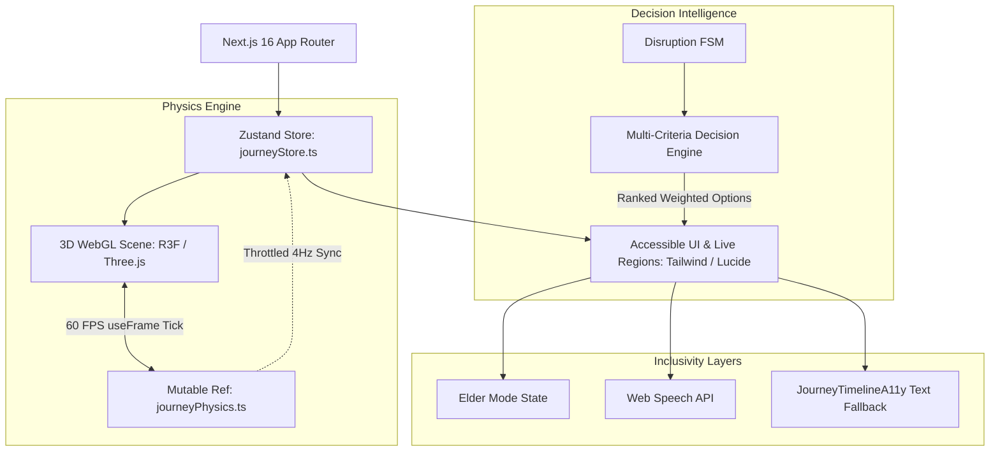

# Sahayak 3D (सहायक ३डी)
### Accessible Moving 3D Rail Journey & Disruption Decision Simulator

[-009E73?style=for-the-badge)](./a11y-statement.md)
[](./a11y-statement.md)
[](#running-unit-tests)

---

## 1. Problem Statement

Every day, millions of passengers navigate the Indian Railways network. When an unexpected signal failure, section halt, or platform reassignment occurs:
1. **Passengers experience panic and uncertainty**, having no immediate visibility into why their train stopped or what connecting options remain viable.
2. **Advisories are fragmented or missing**, forcing passengers to calculate complex trade-offs (e.g., waiting vs. taking an unreserved bypass chord vs. rebooking).
3. **Accessibility is severely neglected**, leaving senior citizens, screen-reader users, and non-English speakers stranded without accessible guidance.

**Sahayak 3D** solves this by combining a real-time, low-poly 3D rail corridor simulation with an ethical, deterministic Multi-Criteria Decision Engine and universal WCAG 2.1 AA accessibility (including Elder Mode, Web Speech voice interaction, and Family Live Sharing).

> **Important Simulation Disclaimer:**  
> All train numbers (e.g. *Express 00001*), station signals, and passenger statuses in this application are **purely simulated** for UX and hackathon research purposes. No official IRCTC or Indian Railways credentials or proprietary databases are used.

---

## 2. System Architecture

Sahayak 3D is architected around a strict separation of concerns to maintain smooth 60 FPS motion without thrashing React render trees:



### Key Architectural Pillars:
1. **Zero-Per-Frame Zustand Updates (`journeyPhysics.ts`)**:
   High-frequency locomotive position ($x, y, z$), wheel angles, bogie sway, and spline progress are stored in a mutable physics ref. Three.js `useFrame` directly reads this ref, completely eliminating 60fps React component re-rendering overhead.
2. **Deterministic Decision Engine (`src/engine/decisionEngine.ts`)**:
   When a disruption occurs (Signal 104 Red, 25-minute delay, section cancellation), the engine evaluates candidates across Arrival Confidence, Time Savings, Comfort Score, Financial Cost, and Complexity.
   - *Authentic Trade-offs*: Short delays (10m) prioritize **Hold & Wait** (₹0, 4/5 comfort, 94% confidence). Severe delays offer a **Chord Bypass Detour** which saves 22 minutes but penalizes comfort (3/5) with unreserved seating.
3. **2D Accessible Fallback View**:
   If WebGL is disabled or unsupported, Sahayak 3D automatically renders a full HTML timeline and decision panel so the app remains 100% operational without 3D graphics.

---

## 3. Accessibility & Inclusivity (WCAG 2.1 AA Verified)

Audited with **Google Lighthouse CLI v13.5.0** and the **Axe-Core v4.13** engine:
- **100 / 100 Accessibility Score** (Desktop and Mobile)
- **Okabe-Ito Colorblind-Safe Standard**: All statuses pair high-contrast colors (`#009E73`, `#E69F00`, `#D55E00`, `#0072B2`) with geometric SVG glyphs (`CheckCircle2`, `AlertTriangle`, `OctagonAlert`, `GitBranch`) and visible text. Status never relies on color alone.
- **Elder Mode (वरिष्ठ मोड)**: Enlarges typography up to 24px, sets min 48×48px tap targets with 2px solid amber borders, simplifies the HUD, and slows 3D motion by 36%.
- **Reduced Motion**: Full support for `prefers-reduced-motion` and manual in-app toggle. Stops camera sway, freezes signal pulsing, and cross-fades transitions.
- **Voice Assistant (Web Speech API)**: Natural speech input ("Train delayed 25 minutes") mapped to simulation states and spoken back aloud. Includes privacy notice and browser feature detection.
- **Full Keyboard Trapping & Restoration**: All dialogs trap focus on Tab/Shift+Tab, restore focus upon exit, and dismiss instantly on **Escape**.
- **Polite Live Regions**: Banners use `aria-live="polite"` (`assertive` strictly reserved for cancellations).

Full audit details in [a11y-statement.md](./a11y-statement.md) and design specifications in [/design-system](http://localhost:3000/design-system).

---

## 4. Getting Started

### Prerequisites
- Node.js 18.18+ or Node.js 20+
- npm or pnpm

### Installation
```bash
# 1. Clone repository
git clone https://github.com/Jatinkumar2503/Sahayak.git
cd sahayak

# 2. Install dependencies
npm install

# 3. Run development server
npm run dev
```
Open [http://localhost:3000](http://localhost:3000) in your browser.

---

## 5. Production Build & Verification

```bash
# Build optimized production bundle
npm run build

# Start production server
npm run start
```

### Running Unit Tests
Validate the deterministic Multi-Criteria Decision Engine test suite:
```bash
node src/engine/__tests__/runTests.mjs
```
Expected output:
```text
Running Decision Engine deterministic tests...
✔ Test 1: Normal state returns empty options passed
✔ Test 2: Short delay ranks Hold & Wait as #1 with ₹0 cost passed
✔ Test 3: Long delay ranks Branch Reroute as #1 saving 22 minutes passed
✔ Test 4: Missed connection provides shortcut with 84% hedged confidence passed
✔ Test 5: Cancellation provides guaranteed seat transfer with fee protection passed
✔ Test 6: Platform change provides crossover and battery cart accessibility passed
All 6 Decision Engine Unit Tests PASSED successfully!
```

---

## 6. Deployxa Deployment Guide

Sahayak 3D is fully production-ready and optimized for deployment on **Deployxa** or containerized cloud hosts:

### Step-by-Step Deployxa Instructions:
1. **Connect Repository**:
   Point your Deployxa project to `https://github.com/Jatinkumar2503/Sahayak.git` (branch `main`).
2. **Build Settings**:
   - **Framework Preset**: Next.js
   - **Build Command**: `npm run build`
   - **Start Command**: `npm run start`
   - **Node Version**: `20.x`
3. **Environment Variables**:
   No external API keys are required; all decision rules, audio engines, and WebGL corridors run self-contained in client-side code.
4. **Deploy**:
   Trigger deployment. Verify the live URL in an incognito window and on mobile.

---

## 7. Project Structure

```text
sahayak/
├── a11y-statement.md                 # WCAG 2.1 AA audit & Lighthouse verification report
├── src/
│   ├── app/
│   │   ├── layout.tsx                # Scalable viewport, dark theme, SEO metadata
│   │   ├── page.tsx                  # Main 3D rail corridor experience & modal mounts
│   │   ├── design-system/page.tsx    # Okabe-Ito tokens, typography & motion specs
│   │   └── globals.css               # Focus rings, reduced-motion rules, touch styling
│   ├── components/
│   │   ├── 3d/                       # React Three Fiber WebGL corridor components
│   │   │   ├── Scene.tsx             # Canvas, low-power FPS sampler, WebGL fallback
│   │   │   ├── Train.tsx             # 5-coach articulated train with Hermite bogie blend
│   │   │   ├── TrackSpline.tsx       # Main line and glowing chord detour splines
│   │   │   ├── LowPolyTerrain.tsx    # Procedural terrain, instanced trees & OHE masts
│   │   │   ├── Stations.tsx          # Devanagari & English railway station signboards
│   │   │   ├── SignalHeads.tsx       # Signal 104 with danger/caution/clear aspects
│   │   │   ├── BrakeSparks.tsx       # Electric locomotive friction sparks
│   │   │   └── FollowCamera.tsx      # Chase, Cinematic Side, and Map camera modes
│   │   └── ui/                       # Accessible UI Overlay & Decision Cards
│   │       ├── Overlay.tsx           # HUD, language toggle, elder mode, lite mode
│   │       ├── DecisionCardsOverlay.tsx # Ranked multi-criteria advisory cards
│   │       ├── DisruptionPanel.tsx   # Interactive rail disruption simulation triggers
│   │       ├── FamilyShareModal.tsx  # Simulated live family tracking phone frame
│   │       ├── VoiceAssistantModal.tsx # Web Speech API voice assistant
│   │       ├── OnboardingModal.tsx   # 3-step introductory walkthrough
│   │       ├── JourneyTimelineA11y.tsx # Full semantic HTML text alternative
│   │       └── StatsOverlay.tsx      # Real-time frame time, draw calls & triangles
│   ├── engine/
│   │   ├── decisionEngine.ts         # Multi-criteria weighted ranking algorithm
│   │   └── __tests__/                # Deterministic unit test runner
│   ├── i18n/
│   │   └── translations.ts           # Complete English and Hindi localization dictionary
│   ├── store/
│   │   ├── journeyStore.ts           # Zustand reactive UI state & localStorage sync
│   │   └── journeyPhysics.ts         # Mutable 60fps physics reference
│   └── styles/
│       └── tokens.ts                 # Okabe-Ito hexes, typography, and motion tokens
```

---

## 8. License & Acknowledgements
- Developed for the UI/UX & Accessible Rail Innovation Hackathon.
- Visual aesthetic inspired by the iconic Northern Railway corridor (New Delhi to Ambala).
- Colorblind accessibility standard derived from Masataka Okabe and Kei Ito (2002).
